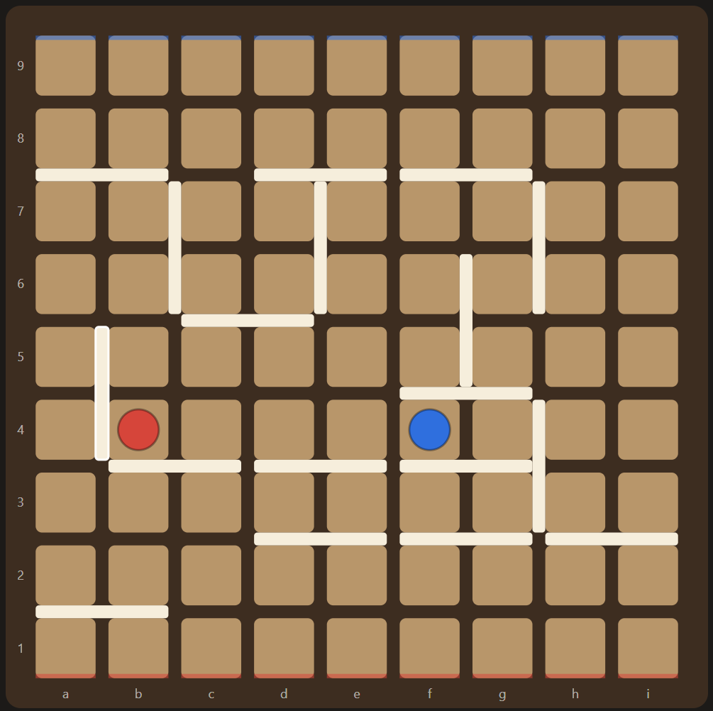
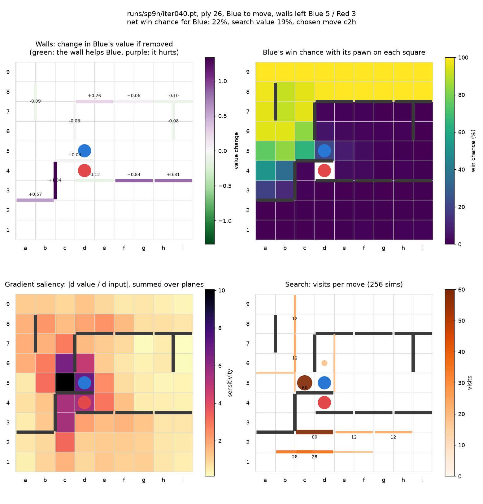
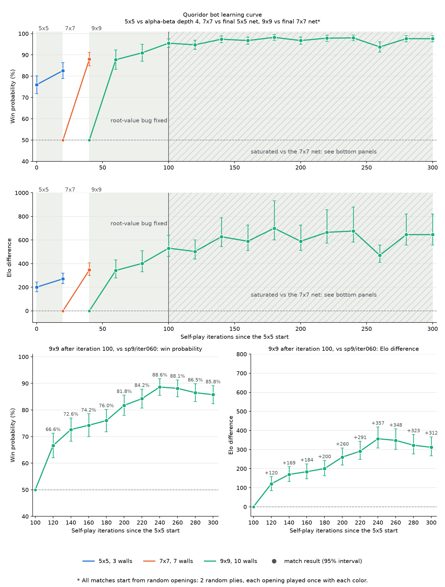

# Quoridor-Zero

An AlphaZero-style bot that learns Quoridor through self-play.

<p align="center">
  
</p>

[Quoridor](https://en.wikipedia.org/wiki/Quoridor) is a two-player board game where each player races a pawn to the far side of a 9x9 board, and on each turn either moves the pawn or places a wall to slow the other player down. Walls may never cut a player off completely. I use the standard two-player rules: 10 walls each, a diagonal jump only when a straight jump is blocked, and no passing. A game is considered a draw after 324 moves (which is 4 times the area of the board) in total.

This project has three parts:

- A game engine in C++, with a classic alpha-beta search (a bot that looks a fixed number of moves ahead and scores positions with a hand-written formula).
- A neural network that looks at a position and suggests moves and a win chance.
- A tree search (Monte Carlo tree search, with the Gumbel AlphaZero method at the top of the tree) that uses the net to look ahead. Gumbel AlphaZero makes good decisions with only a few dozen simulations, which keeps training cheap.

The net learned by playing against itself. It plays games with search, trains on the results, and repeats.

## Strength

I tested the 9x9 bot against two public Quoridor bots I found on GitHub. Results are this bot's wins-losses:

| Opponent | This bot | Random openings | Standard start |
|---|---|---|---|
| [SigmaQuoridor](https://github.com/bartolomeo3000/SigmaQuoridor) (AlphaZero-style, a larger net), 800 simulations | 800 simulations | 22-18 | lost both games |
| [gorisanson/quoridor-ai](https://github.com/gorisanson/quoridor-ai), strongest level (60,000 playouts per move) | 64 simulations | 37-3 | won both games |

The 40 games start from 20 random two-move openings, each played once with each colour, so the bots don't repeat the same game. SigmaQuoridor is about as strong as mine, and from the standard start it won both games. Against gorisanson's bot, mine needed well under a tenth of a second per move against about 9 seconds.

## Setup

Needs Python 3.10+ and a C++17 compiler. A GPU is optional, but without one use fewer simulations in the UI.

```sh
pip install -r requirements.txt
bash build.sh
./build/test_engine && python -m tests.test_bindings && python -m tests.test_mcts
```

## Play

```sh
python -m quoridor.ui                  # browser UI at http://localhost:8000
python -m quoridor.play --you red      # terminal, against alpha-beta
```

The UI starts with the 9x9 bot at 512 simulations and its opening book. In the browser you can play against the alpha-beta bot or any trained net, watch two bots play, step back and forth through a game, and see the net's win chance. "Inspect position" shows what the net thinks of the position on screen:

<p align="center">
  
</p>

Top left: how much the mover's win chance changes if each wall were removed. Top right: the mover's win chance with its pawn on each square. Bottom left: which squares the net's evaluation is most sensitive to. Bottom right: where the search spent its simulations.

## How it learned

I started by training the net on small boards. Small boards are much faster to train on, and on very small boards the alpha-beta engine can solve positions exactly, which gave me a way to check whether the net was right.

1. 5x5. The first net learned from games played by the alpha-beta bot, then improved through self-play.
2. 7x7. The net uses global pooling (it summarises the whole board into a few numbers), so the same weights work on any board size. I continued training the 5x5 net on 7x7.
3. 9x9. The same net again, now trained on the full board for 280 iterations. Along the way I fixed a bug in how the search reported its value and made some modifications.

I also tried many tricks from KataGo on 5x5 first. Most of them didn't help here, so I removed them.

<p align="center">
  
</p>

Above are the first 300 training iterations. Each point is a 400-game match against a fixed opponent. Top: 5x5 against the alpha-beta bot, 7x7 against the final 5x5 net, 9x9 against the final 7x7 net. Bottom: the later 9x9 nets against an earlier 9x9 net, because the 9x9 nets beat the 7x7 one almost every game. Elo is a rating scale where a 200-point gap means the stronger side wins about 76% of games. The curve flattens at the end, partly because the reference becomes too weak to separate the newest nets. Since I made some modifications along the way, a fresh training run might produce different curves from mine.

### The shipped nets

I trained a lot of bots and only kept a few. The names follow the training runs:

- `sp` is a self-play run. `sp1` was the first (5x5), `sp7` is 7x7, `sp9` is 9x9.
- Letters mark continuations: `sp9b` continued `sp9`, `sp9c` continued `sp9b`, and so on up to `sp9h`.
- `iterNNN` is the checkpoint after that many training iterations. One iteration is 1,000 self-play games followed by a round of training.

| File | Board |
|---|---|
| `runs/sp1/iter020.pt` | 5x5, 3 walls each |
| `runs/sp7/iter020.pt` | 7x7, 7 walls each |
| `runs/sp9h/iter040.pt` | 9x9, 10 walls each (the strongest, used by default) |

All three are the same size: a residual network with 6 blocks and 64 channels. The 9x9 bot also uses an opening book (`books/book_9x9w10.json`): the first few moves searched deeply in advance.

## Train your own

Continue from the 9x9 bot (about 2 minutes per iteration on a 6 GB GPU):

```sh
python -m quoridor.selfplay --init runs/sp9h/iter040.pt --run my_run
```

The defaults are the settings that trained the 9x9 bot (40 iterations). Or start from a random net with `--init scratch --board 5 5 3 --lr 5e-4` (any board up to 9x9). Compare two nets:

```sh
python -m quoridor.arena runs/my_run/iter020.pt --opponent runs/sp9h/iter040.pt \
    --games 400 --sims 64 --open-plies 4 --open-temp 3
```

Build an opening book:

```sh
python -m quoridor.book runs/sp9h/iter040.pt --out books/my_book.json --plies 8 --replies 8
```

## Commands

| Command | What it does |
|---|---|
| `python -m quoridor.ui` | Browser UI: play or watch bots, step through games, inspect positions |
| `python -m quoridor.play` | Play in the terminal against the alpha-beta bot |
| `python -m quoridor.selfplay` | Train a net by self-play |
| `python -m quoridor.arena` | Match a net against the alpha-beta bot or another net |
| `python -m quoridor.book` | Build an opening book |
| `python -m quoridor.explain` | Save the position explanation figure shown above |
| `python -m quoridor.probe` | Check 5x5 nets against exact solver results |
| `python -m quoridor.gen_data` | Generate training data from alpha-beta games |
| `python -m quoridor.train` | Train a net on that data (how the first 5x5 net started) |

Every command takes `--help` for its options.

## Layout

| Path | Contents |
|---|---|
| `cpp/` | Engine, alpha-beta search, tree search, Python bindings, C++ tests |
| `quoridor/` | Net, self-play training, matches, opening book, browser and terminal UI |
| `tests/` | Python tests |
| `runs/` | The shipped nets; new runs are saved here |
| `books/` | Opening books |
| `plots/` | Figures |

## References

- Silver et al., [Mastering Chess and Shogi by Self-Play with a General Reinforcement Learning Algorithm](https://arxiv.org/abs/1712.01815) (AlphaZero), 2017.
- Danihelka et al., [Policy Improvement by Planning with Gumbel](https://openreview.net/forum?id=bERaNdoegnO) (Gumbel AlphaZero), 2022.
- Wu, [Accelerating Self-Play Learning in Go](https://arxiv.org/abs/1902.10565) (KataGo), 2019.
- Grant Slatton, [Solving Quoridor](https://grantslatton.com/solving-quoridor): exact results on small boards, which I used to check my engine.

## License

[MIT](LICENSE)
